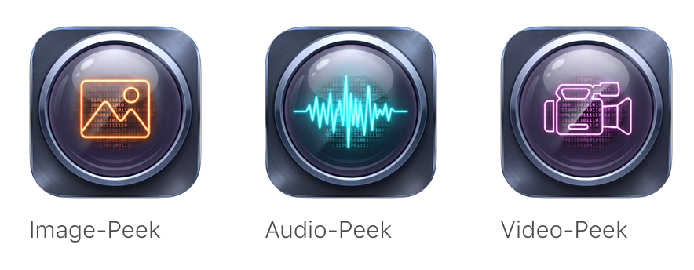

# peek-apps
Peek Apps (Image-Peek, Audio-Peek and Video-Peek) 
 
 

  
  
Modern creative work doesn’t happen in a single format. Video editors balance pristine mixdowns. Photographers deliver cinematic motion. Audio engineers master against locked picture. Media doesn’t live in silos—and your inspection tools shouldn’t either.

Today’s pipelines are fluid. You grade footage in the morning, inspect print-ready key art in the afternoon, and master audio stems before wrap. When your deliverables span the full digital spectrum, your quality control has to match.

**Peek-Apps** is a trinity of crafted utilities built for Image, Audio, and Video workflows—available as one unified bundle on the App Store. Elevate your craft. See what others miss.

🍎 Download the [Peek-Apps Bundle on the Mac App Store](https://apps.apple.com/us/app-bundle/peek-apps/id6824282225?mt=12) today and bring studio-grade precision to your workflow.
