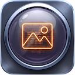
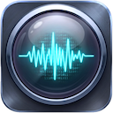
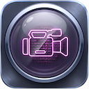

## Crafted exclusively for macOS

<!--Focused, lightweight, and native tools built to boost productivity and enhance your everyday workflow for Image, Audio and Video -->
Modern creative work doesn't happen in single formats. Video editors balance pristine mixdowns. Photographers deliver cinematic motion. 
Audio engineers master against locked picture. Media doesn't live in isolated boxes and hence your inspection tools shouldn't either.
 
Creative pipelines are completely fluid. We grade footage in the morning, inspect print-ready key art in the afternoon, 
and master audio stems before wrapping up. Your deliverables span the full digital spectrum and your quality control should too.
Peek-Apps is a trinity of crafted utilities for enhancing your Image, Audio and Video workflows available as one bundle on the App Store. 
 

  
  <!-- Image-Peek -->
  

    

      

        
        <h3 class="app-title">Image-Peek</h3>
      

      
Elevate Your Digital Photography & Imaging Workflow: Native, high-performance image spec analyzer, deep EXIF/optical inspector, and A-B image comparator built for macOS.

    

    

      <a href="https://barshasantak.github.io/image-peek" target="_blank" rel="noopener" class="btn btn-secondary">Learn More</a>
      <a href="https://apps.apple.com/us/app/image-peek/id6817664535?mt=12" target="_blank" rel="noopener" class="btn btn-primary">App Store ↗</a>
    

  

  <!-- Audio_Peek -->
  

    

      

        
        <h3 class="app-title">Audio-Peek</h3>
      

      
Elevate Your Audio Workflow: The native, studio-grade audio specification analyzer and side-by-side A-B diff comparator engineered exclusively for macOS.

    

    

      <a href="https://barshasantak.github.io/audio-peek" target="_blank" rel="noopener" class="btn btn-secondary">Learn More</a>
      <a href="https://apps.apple.com/us/app/audio-peek/id6817665269?mt=12" target="_blank" rel="noopener" class="btn btn-primary">App Store ↗</a>
    

  

  <!-- Video-Peek -->
  

    

      

        
        <h3 class="app-title">Video-Peek</h3>
      

      
Elevate Your Video Mastering & Workflow: The native, studio-grade video specification analyzer and side-by-side A-B diff comparator engineered exclusively for macOS.

    

    

      <a href="https://barshasantak.github.io/video-peek" target="_blank" rel="noopener" class="btn btn-secondary">Learn More</a>
      <a href="https://apps.apple.com/us/app/video-peek/id6817666279?mt=12" target="_blank" rel="noopener" class="btn btn-primary">App Store ↗</a>
    

  

  

It’s not just a toolkit; it's a permanent badge of professional assurance. When you hit Deliver, you will never have to cross your fingers again.

Elevate your craft. See what others miss.

🍎 Download the [Peek-Apps Bundle on the Mac App Store](https://apps.apple.com/us/app-bundle/peek-apps/id6824282225?mt=12) today and bring studio-grade precision to your workflow.

  
 
### Need Support or Have Feedback?
Contact us by creating an issue for the respective app at [https://forms.gle/XDUkjJ2TJzEruakX9](https://forms.gle/XDUkjJ2TJzEruakX9).

  
 
 

 
 <small>*© 2026 Santak Das, Tara Design Studio. All rights reserved.*</small>

  
